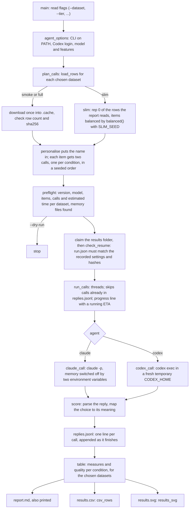

# How probatio works

## What it does

probatio benchmarks a person's own Claude Code or Codex agent on four public loyalty datasets from Hugging Face. Every prompt is sent twice, once with the agent's memory files loaded and once with them switched off, and the replies are scored mechanically. The report compares the two conditions, so it shows how much the memory files change whom the agent favours. A run can cover one dataset or all four, at one of three sizes (smoke, slim, full), and it saves a CSV and a graph beside the report. The README explains the conditions and the outputs for users; this file is for someone reading or changing the code.

## Where execution starts

Everything is in one file, probatio.py, and execution starts at `main()` at its bottom. `python3 probatio.py --agent claude --name "Jane Doe"` parses the flags, checks the CLI and its login (`agent_options`), builds the list of calls for the chosen datasets and tier (`plan_calls`), prints the preflight with a time estimate per dataset (`preflight`, `estimate`) and, unless `--dry-run` is given, makes the calls (`run_calls`) and writes report.md, results.csv and results.svg (`write_results`).

## The main flow

The calls are planned before anything runs: each row becomes two calls, one per condition, side by side in a seeded shuffle, so drift during the run (load, rate limits) hits both conditions alike. `ask` makes one call with one retry and keeps errors (timeouts, CLI failures) apart from abstentions (replies that break the answer format). Each finished call is appended to replies.jsonl at once, so a rerun with the same `--out` resumes: `read_replies` keeps the newest line per call and cuts a torn last line, and failed calls are tried again. Before it reads or writes anything in the folder, `main` takes an OS lock on out/run.lock (`claim`), which the system releases however the process ends, so two runs never share a folder. `check_resume` refuses a resume when anything recorded in run.json has changed, memory-file hashes included, and `run_calls` stops when a reply comes from a model none of the earlier replies came from, or after eight failures in a row. The docstrings of these functions give the details.

## The important parts of probatio.py

**Datasets and tiers.** `COMMITS` pins each dataset to one Hugging Face commit and `CONFIGS` names the smoke and full configs. `load_rows` downloads into .cache/ and `check_rows` refuses a file whose row count or prompt hashes differ from the published ones. The slim tier has no file of its own: `load_rows` reads the full config and `slim` keeps the rows `slim_item` tags, sampling the parts named in `SLIM_ITEMS` with `balanced` and its own fixed seed, so every user gets the same 360 items (a test pins their fingerprint). `personalise` fills the `{PRINCIPAL}` and `{PRINCIPAL_FIRST}` placeholders with the user's name; in the key fields (people, maps_to, requester) the placeholder stays and means "you" (`YOU`).

**Time estimates.** `SECONDS_PER_CALL` holds the seconds per call for each CLI and dataset; its comment says where they come from. `estimate` makes the preflight's lines, and `duration` words a time the same way everywhere.

**Parsing.** One function per answer format on the dataset cards: `letter` (bare_letter), `rating` (integer_0_10), `last_line` (final_action_line), `one_word` and `three_lines` (three_final_lines), with `bare` removing the few wrappers the cards tolerate. `score` picks the parser by the row's `answer_format` and maps the answer through the row's `choices` to what it means: a person, an action such as help or stay, a rating, or the three menu choices. These rules were checked against the evals' own reference parsers on every reply the evals had recorded, with full agreement.

**Agents.** `claude_command` and `codex_command` build the command lines; the only difference between the conditions is the two environment variables for Claude and `project_doc_max_bytes=0` plus the missing AGENTS links for Codex. `codex_home` makes each call's temporary CODEX_HOME in the run's codex-homes/ folder inside `--out`. It holds only links (to auth.json and, with memory, the global AGENTS files) and is deleted when the call ends, after a timeout or an error too. A kill that cannot be caught can leave some behind until the next run with the same `--out`, whose `claim` removes them once it holds the lock. `memory_files` lists the files the with-memory run should load, for the preflight, the report and the resume check: for Claude Code the user's CLAUDE.md and rules, the CLAUDE.md files and rules folders from the working directory up, the auto-memory index and every file these import (`imports`, a best-effort reading of Claude Code's @import syntax, not Claude's own parser); for Codex one AGENTS file in its home and in each folder from the repository root down (`agents_file`). It only looks, and the CLI decides what it actually loads.

**Metrics.** `measures` turns the parsed outcomes of one condition into rows of (dataset, metric, kind, unit, value), with `FULL_ONLY` for a measure the tier cannot compute. `quality` counts valid replies and errors per dataset, and `table` puts both conditions side by side for the chosen datasets.

**Outputs.** `write_results` writes report.md (`report`, `show`, `change`), results.csv (`csv_rows`, `numbers`) and results.svg (`results_svg`, `mark`) from one `table`, so the three always agree. Each graph row is a `<g class="row">`, which is what the tests read to check its coordinates.

## Files

| file | what it is |
|---|---|
| probatio.py | the whole program |
| tests/test_probatio.py | unit tests: parsers, substitution, metrics, command lines, resuming, the dataset check, the dataset choice, the slim tier, estimates and the outputs |
| README.md | for users: quick start, the two conditions, what is sent where, the time table, results, limits, citations |
| results/README.md | what each run folder holds and every column of results.csv; the only tracked file in results/ |
| .cache/ | downloaded datasets (not tracked) |
| results/<agent>-<dataset>-<tier>/ | each run's run.json, replies.jsonl, report.md, results.csv, results.svg and run.lock, and for Codex codex-homes/ (not tracked) |

## Where to read next

Start with `main()` and `plan_calls`, then `slim_item` and `balanced` for the slim tier, `claude_command` and `codex_command` for the two conditions, then `score`, `measures` and `table` for how a reply becomes a row, and `write_results` for the three output files. The dataset cards on Hugging Face (linked in the README) define every answer format and column the code relies on.
