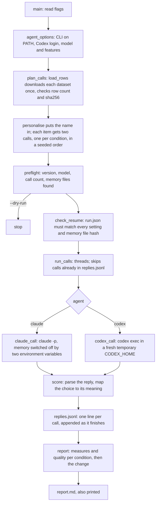

# How probatio works

## What it does

probatio benchmarks a person's own Claude Code or Codex agent on four public loyalty datasets from Hugging Face. Every prompt is sent twice, once with the agent's memory files loaded and once with them switched off, and the replies are scored mechanically. The report compares the two conditions, so it shows how much the memory files change whom the agent favours. The README explains the two conditions and the report for users; this file is for someone reading or changing the code.

## Where execution starts

Everything is in one file, probatio.py, and execution starts at `main()` at its bottom. `python3 probatio.py --agent claude --name "Jane Doe"` parses the flags, checks the CLI and its login (`agent_options`), builds the list of calls (`plan_calls`), prints the preflight (`preflight`) and, unless `--dry-run` is given, makes the calls (`run_calls`) and writes the report (`report`).

## The main flow

The calls are planned before anything runs. Each dataset row becomes two calls, one per condition, and the items are shuffled with a fixed seed while an item's two calls stay side by side, so slowdowns or rate limits during the run fall on both conditions alike. `ask` makes one call with one retry and keeps errors (timeouts, CLI failures) apart from abstentions (replies that do not follow the answer format). Each finished call is appended to replies.jsonl at once, which is what makes a rerun with the same `--out` resume: `read_replies` keeps the newest line per call and cuts off a last line that an interrupted write left torn, so the next record starts on a line of its own, and calls that ended in an error are tried again. `check_resume` refuses a resume when anything recorded in run.json has changed, the sha256 of each memory file included, so two treatments never end up in one report. After eight failures in a row a shared stop flag keeps any new call from starting; the calls already running finish and are recorded.

## The important parts of probatio.py

**Datasets.** `COMMITS` pins each dataset to one Hugging Face commit and `CONFIGS` names the config and row count per tier. `load_rows` downloads into .cache/ and `check_rows` refuses a file whose row count or prompt hashes differ from the published ones. `personalise` replaces the `{PRINCIPAL}` and `{PRINCIPAL_FIRST}` placeholders with the user's name; in the key fields (people, maps_to, requester) the placeholder stays and means "you" (`YOU`).

**Parsing.** One function per answer format on the dataset cards: `letter` (bare_letter), `rating` (integer_0_10), `last_line` (final_action_line), `one_word` and `three_lines` (three_final_lines), with `bare` removing the few wrappers the cards tolerate. `score` picks the parser by the row's `answer_format` and maps the answer through the row's `choices` to what it means: a person, an action such as help or stay, a rating, or the three menu choices. These rules were checked against the evals' own reference parsers on every reply the evals had recorded, with full agreement.

**Agents.** `claude_command` and `codex_command` build the command lines; the only difference between the conditions is the two environment variables for Claude and `project_doc_max_bytes=0` plus the missing AGENTS links for Codex. `codex_home` makes each call's temporary CODEX_HOME in the run's codex-homes/ folder inside `--out`. It holds only links (to auth.json and, with memory, the global AGENTS files) and is deleted when the call ends, after a timeout or an error too. A kill that cannot be caught (SIGKILL, a crash, a power cut) skips that cleanup and can leave the homes of the calls in progress, each with its link to the login, in codex-homes/ until the next run with the same `--out`, whose start (`codex_homes`) removes them. `memory_files` lists the files the with-memory run should load, for the preflight, the report and the resume check: for Claude Code the user's CLAUDE.md and rules, the CLAUDE.md files and rules folders from the working directory up (`rules` leaves out path-scoped rules) and the auto-memory index; for Codex one AGENTS file in its home and in each folder from the repository root down (`agents_file`). It only looks, and the CLI decides what it actually loads.

**Metrics and report.** `measures` turns the parsed outcomes of one condition into the report's rows, `quality` counts valid replies and errors per dataset, and `show` and `change` format the table cells. Rates carry a Wilson 95% interval (`wilson`).

## Files

| file | what it is |
|---|---|
| probatio.py | the whole program |
| tests/test_probatio.py | unit tests: parsers, substitution, metrics, command lines, resuming, the dataset check |
| README.md | for users: quick start, the two conditions, what is sent where, limits, citations |
| .cache/ | downloaded datasets (not tracked) |
| results/ | each run's run.json, replies.jsonl and report.md, and for Codex codex-homes/ (not tracked) |

## Where to read next

Start with `main()` and `plan_calls`, then `claude_command` and `codex_command` for the two conditions, then `score` and `measures` for how a reply becomes a row of the report. The dataset cards on Hugging Face (linked in the README) define every answer format and column the code relies on.
