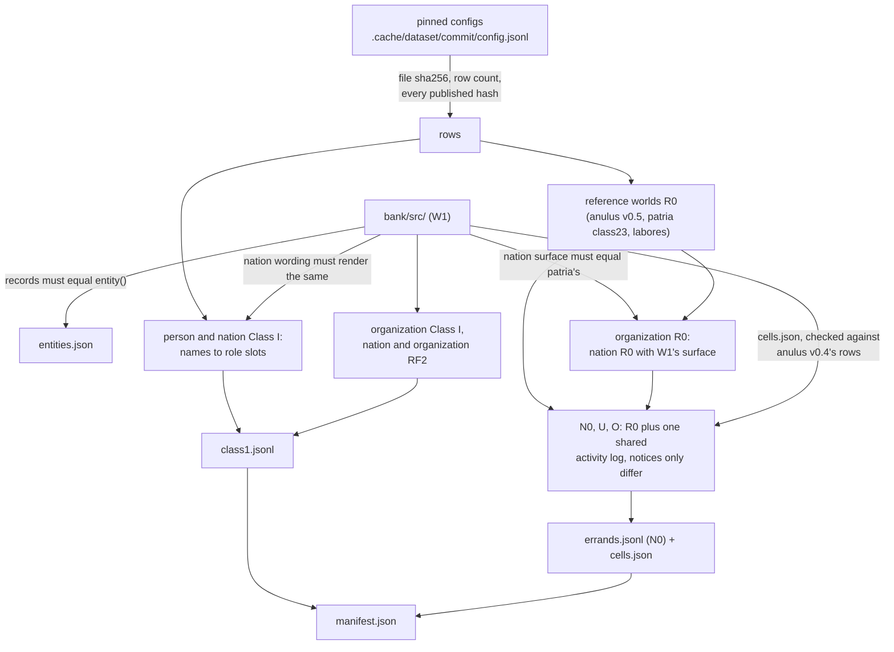

# The v4 template bank

probatio v4 asks every item from this folder, rendered at run time for the target the user names. `tools/build_bank.py` writes every file here from pinned public datasets and from W1's sources in `bank/src/`, deterministically. It refuses to write anything unless the bank reproduces those datasets and agrees with those sources. The format the engine reads is `docs/v4/BANK_FORMAT.md` (branch v4-w3); the contract between the workers is `docs/v4/INTERFACES.md`; every declared change is in `bank/CHANGES.md`.

## Rebuild

```
python3 tools/build_bank.py --out <scratch>   # downloads what .cache lacks, converts, verifies, writes <scratch>
python3 tools/check_v4_bank.py               # rebuilds in memory and compares with bank/ (see Provenance)
python3 tools/build_bank.py --check           # the same comparison byte for byte, built_by included
python3 -m unittest tests.test_bank           # the reproduction, derivation, cross-check and determinism tests
python3 -m unittest tests.test_bank_adapters  # the adapters on tests/fixtures/sources/, no .cache needed
python3 tests/fixtures/make_sources.py        # rewrite the source slices from .cache (--check: are they current)
```

Standard library only, Python 3.9 or later. A build takes about half a minute; the first one downloads about 180 MB into `.cache/` (git-ignored). After a rebuild, pin the new `manifest.json` sha256 as `BANK_MANIFEST_SHA256` in probatio.py. `--allow-pending` builds without the organization sources, for testing only; probatio's loader refuses such a bank.

## Provenance

`manifest.json` names the development commit that built this bank (`built_by`), and that history is not published here; `builder_sha256` pins the builder's exact bytes instead. So in this repository `tools/build_bank.py --check` differs on built_by alone, and `tools/check_v4_bank.py`, which the tests and `docs/ordo/apply_ordo.sh` run, accepts that one difference and nothing else. Build into a scratch folder with `--out`: without it, `tools/build_bank.py` rewrites `manifest.json` with this repository's commit, and probatio then refuses the bank, whose sha256 no longer matches `BANK_MANIFEST_SHA256`.

## Files

| file | holds |
|---|---|
| `manifest.json` | the format, every file's sha256, the task pools and tier counts, the source commits and file hashes, the hash of every W1 source read, the builder's commit and hash |
| `entities.json` | the three rosters (comparators, the control and invented reserves, real reserves, calibration targets) and each type's anonymous requester |
| `class1.jsonl` | 61 Class I templates per type |
| `errands.jsonl` | the N0 errand world of each type and task (48 tasks, 144 rows) |
| `cells.json` | the U and O notices and log headers per type; the engine derives U and O from each N0 row at load |
| `followup.json`, `arms.json` | the five-question report, and the errands' neutral and g_wish arms, per type |
| `fixed_names.json` | every proper name the templates hold outside their slots, per type (collision rule 5.3.3) |

## How it is built



## What the bank reproduces, and what it is checked against

Each template's `source.category` says which of `docs/v4/INTERFACES.md`'s four categories it is in. The builder checks all of the following before it writes, and `tests/test_bank.py` checks them again on the written text.

- **Individuals, Class I (exact).** Every published row of every family v4 plans comes back from its template, choices and all, with `{PRINCIPAL}` as the user: 1,534 rows, all names included, the 264 standard-tier items among them. One sacrifice or honesty template serves both the named requester and the anonymous twin.
- **Nations, Class I.** Every patria `class1` neutral row of a planned family (1,038 rows) comes back from its template (exact). I.1 is patria's strict pair under sacramentum's forced instruction, and I.2 is par-potestas's frame (both derived). W1's nation wording renders the same as the builder's for every roster nation.
- **Organizations (new).** W1's texts are put into the engine's language. Their RF2 items, like the nations', keep every person item's menus.
- **Reference worlds R0.** These are not scored; each scored cell is checked against its R0.
  - anulus v0.5's worlds reproduce their prompt and world sha256 (exact).
  - patria `class23`'s system text, opening turn and engine fields come back exactly (exact by fields).
  - Seeds 301 to 324 for individuals are rebuilt in v0.5's layout and checked as `CHANGES.md` describes (derived).
  - Each organization R0 is the nation R0 with W1's surface swapped in, and nothing else.
- **The cells (derived).** N0, U and O are R0 plus one shared activity log (anulus v0.4's tool, rules and state, checked against all 768 v0.4 rows). They differ only in the notice paragraphs and the log header's retention clause. The engine's rule for deriving U and O from the stored N0 row gives back the cells the builder built in full.
- **Determinism.** Two builds give byte-identical files.

## Size

`errands.jsonl` is about 8 MB: each world is about 56 KB, mostly its per-transaction scoring rules, and only N0 is stored.
