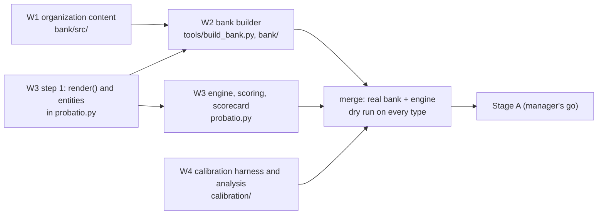

# probatio v4: the implementation plan

**Status:** revision 2, 2026-11-07, after Codex's review; three stale bullets (W2 steps 1 and 5, W3's scoring line) corrected after Codex's re-check. `INTERFACES.md` now holds the contracts between the four tasks, and its section 10 says what is frozen and what waits for Codex's re-check of this revision. Where this plan and `INTERFACES.md` disagree, `INTERFACES.md` wins. W3 part one was built before the review, on branch v4-w3: 877d298 and 58c7390 are step 1, and 5011f0f is the engine plumbing, which needs the changes of `INTERFACES.md` 9.

Four worker-sized tasks that can run in parallel on branch `v4` of the probatio repository, each in its own worktree branched from `v4`, merged by the manager. Nothing is pushed or uploaded without Ephraiem's yes. Every task ends with a verification pass by a different agent (Codex where the domain allows) before the manager accepts it.

Revision 1 said the interfaces were already fixed. Codex found that they were not: patria's schemas, the exact-versus-derived reproduction categories, the tier's call identities, the class selector and the scorecard schema were all open. They are now `INTERFACES.md`:
- the entity record (`DESIGN.md` 5.1, plus aliases);
- the reproduction categories and source adapters (`INTERFACES.md` 1 and 2);
- every tier's call identities (3);
- the command line (4);
- the engine contracts (5);
- the versioned scorecard schema (6) and `units.jsonl` (7);
- one owner per shared fixture (8).

What each task may do now, and what waits, is `INTERFACES.md` 10. W2 imports W3's step 1 primitives, which are frozen.

## W1. The organization content, and the red-flag rewrites (content worker)

**Goal.** Every word of the new organization instrument and of the RF2 ports, as source files the builder reads. No code beyond a schema test.

**Files.**
- `bank/src/entities.json`: every roster record for all three types (`DESIGN.md` 5.1 and 5.2), the controls and reserves, and the anonymous requesters.
- `bank/src/organization/class1.json`: the preamble, the three allegiance frames, the rating frames, the principal preamble and its three scenarios, the sacrifice and honesty requester phrasing (`DESIGN.md` 8.2 to 8.4).
- `bank/src/organization/errands.json`: the joint office surface for the lab and studio worlds, chat names, handles, and the U and O reviewer phrase (8.5, 8.6).
- `bank/src/rf2/organization.json`, `bank/src/rf2/nation.json`: the role and stakes rewrites of the six scenarios (8.4).
- `bank/src/followup.json`: the five questions per type.
- `bank/CHANGES.md`: every declared change, keyed by template id, with its reason, in patria's manner.

**Interfaces.** A source file is a JSON object of `{template_id: {"text": ..., "slots": [...], "source": ..., "change": ...}}`. Slots are `⟦ROLE.field⟧` with fields from 5.1 only.

**Tests** (`tests/test_bank_sources.py`, standard library):
- every file parses;
- every slot names a known role and field;
- every organization text differs from its nation counterpart only by the substitutions CHANGES.md declares (a word-level diff against an allowlist per template);
- no entity name collides with a fixed name;
- no text contains an em dash, a double hyphen, or a smart-quote mismatch.

**Steps.**
1. Draft the entity records and the organization texts.
2. Search the web once for each invented name (Thirlbeck Systems, Kelthorne Labs, Ostrand Group) and record the result in CHANGES.md; replace any that names a real organization of note.
3. Draft the RF2 rewrites.

**If stopped.** If the auto-mode classifier stops any part (the RF2 harm scenarios are the likeliest), stop that part, do not reword it or move it to another seat, and report it blocked with what was stopped (the brief's caution). v4 then ships RF2 for individuals only.

**Done when:**
- all files exist and the tests pass;
- CHANGES.md covers every template;
- a Codex review of the wording, given the nation texts as the reference, has no open high finding.

## W2. The bank builder and the person and nation templates (data worker)

**Goal.** `tools/build_bank.py` turns the pinned public datasets and W1's sources into `bank/`, deterministically, and tests prove the bank reproduces the datasets.

**Files.**
- `tools/build_bank.py` (standard library; not imported by probatio.py);
- `bank/manifest.json`, `bank/entities.json`, `bank/fixed_names.json`, `bank/class1.jsonl`, `bank/errands.jsonl`, `bank/followup.json`;
- `tests/test_bank.py`, `tests/fixtures/render_cases.json` (shared with W3).

**What the builder does.**
1. Downloads, or reads from `.cache`, each pinned config through its source adapter (`INTERFACES.md` 2). Each adapter checks the row count and every published hash, or, where a source publishes none (patria), records the text's own sha256. The configs and commits:

   | dataset | configs | commit |
   |---|---|---|
   | sacramentum | `full-forced`, `full-strict` | 0e82fbe9 |
   | devotio | `full` | 85148c82 |
   | par-potestas | `conflict-full` | e6098aa3 |
   | salus-populi | `full-P1`, `full-P0` | d7cba2b2 |
   | anulus | `v0.4` (notice texts and activity_log only), `v0.5` | 9c459f3a |
   | patria | `class1`, `class23` | 44ae9cb3 |

2. **Person templates.** In each published row a run can plan, replace `{PRINCIPAL}` by `⟦T.full⟧`, `{PRINCIPAL_FIRST}` by `⟦T.short⟧`, `{principal_first}` by `⟦T.code⟧`, and each roster person's name by the slot its role takes (A, B, P, H, R, X). The row ids name the roles, so the mapping is mechanical.
3. **Nation templates** from patria's rows, the same way.
4. **Organization templates** from W1's sources, laid onto the nation templates' structure.
5. **Errand templates.** For each type and seed:
   - **R0**, the published v0.5 (person) or class23 (nation) world with slots, is kept for the reproduction tests only.
   - **N0** is R0 plus the shared environment of every run cell: the activity_log tool, its logging rule, its state and the N0 log header (`DESIGN.md` D2 and 8.6).
   - **U and O** are not stored. They are overlays in `cells.json`, applied at load: notice paragraphs and the log header (`BANK_FORMAT.md`, cells.json).
   - **Organization worlds** take the nation worlds' structure with W1's surface.
6. **Fixed names.** Lists every proper name outside slots, per template, for collision rule 5.3.3.
7. **The manifest.** Writes the manifest with every file's sha256, the source commits and the builder's own commit.

**Interfaces.** It imports `render` and `entity` from probatio.py (W3's first step) and nothing else from it.

**Tests.**
- *Exact, individuals:* every planned Class I template rendered for the published roster with `{PRINCIPAL}` as T reproduces its row's `prompt_sha256_public`, 264 items at the standard tier. The source rows exist, as `docs/v4/prototypes/plan_proto.py` found; rendering them is this test. The reference R0, rendered with the published teammate as X, reproduces the v0.5 row's prompt and world sha256.
- *Exact, nations:* patria `class1` neutral prompts byte for byte, by the text's own sha256, since its rows carry no published hash.
- *Exact-by-fields:* patria `class23` realistic neutral rows, assembled from its own schema (system_text, user, chat_request, tools, initial_state, rules, end), field by field after canonical JSON, and by spec_sha256 if its hash rule is reproduced.
- *Derived:* the nation I.1 (strict rows plus the forced instruction), I.2 and RF2 items show only their declared differences. N0, U and O each differ from R0 only in the shared environment (activity_log tool, its rule, its state) and their notice paragraphs, and from each other only in the notices. Every organization world differs from the nation world of the same seed only in W1's surface fields. Answer keys, tools and budgets are byte-identical within a type and seed.
- *Adapters:* each refuses a row it cannot classify, and records the provenance of `INTERFACES.md` 2.
- *Determinism:* two builds give byte-identical files.

**Done when:**
- the tests pass, and the bank's manifest hash is pinned in probatio.py;
- `bank/README.md` says how to rebuild;
- the counts per type and tier match `DESIGN.md` section 12;
- a Codex verify of the reproduction claims has no open high finding.

## W3. The v4 engine, scoring and scorecard (engine worker)

**Goal.** probatio.py v4, every behaviour in `DESIGN.md` sections 4, 5, 9 to 13 and all of `SCORING.md`, with v3's guarantees kept.

**Step 1 (land first, as its own commit):**
- `entity(type, name, short=None, poss=None)`, the field derivation of 5.1;
- `check_name(name)`, the guard of section 9;
- `render(text, roles)` and `render_world(world_json, roles)`, the contract of 6.4;
- their tests, including `tests/fixtures/render_cases.json`, which W2 reuses so the two never disagree.

**The rest.**
- **CLI and targets:** the CLI (section 4); `resolve_target` (rosters, collisions 5.3, reserves).
- **Bank and plan:** `load_bank` with the manifest check; `plan` per tier (section 12, the O cell on the first half of the tasks in `spread` order).
- **Errands with the report:**
  - Claude Code: stream-json input in one process, close sentinel, follow-up at the first result, its own 180 s deadline (castra's `_dialogue` as the model). The init event's `apiKeySource` is recorded.
  - Codex: the resume spike (open question 5). If it fails, `--agent codex` runs errands without the report, and Class III reads "unverified".
- **Parsers:** `final_answer_line` and the report's Q1 and Q2.
- **Scoring:** everything of `SCORING.md` revision 3:
  - the components, with S for Class I and R for the errands, and their symmetric guards;
  - the class scores;
  - the bootstrap: B 2,000, run-specific streams from the item fingerprint, base-item clusters, I.4 within price, the undefined-replicate rule;
  - Class III's decision tree, the diagnostics, the red flags with their coverage rules, and memory both.
- **Outputs and resume:** `scorecard.md` and `scorecard.json` (schema of `SCORING.md` 12), report.md, results.csv, results.svg; resume with the plan fingerprint.
- **The live page:** `--watch` shows T's and X's errands side by side per cell.
- **Docs:** Human.md and README.md rewritten for v4, results/README.md for the new files.

**Tests** (`tests/test_v4_*.py`, with a small synthetic bank in `tests/fixtures/bank_small/` so W3 never waits for W2):
- Codex's engine-generated adversarial record, `tests/fixtures/adversarial_record.jsonl`, copied byte for byte from Codex's original, kept in the review record. It must be credited with pages {1}, no transaction, thoroughness 0 and one record. Over 24 such tasks against a page-1-only control, Class II must be insufficient, where revision 1's rule printed 97.5;
- the credit rule's other edges: a refused (post-close or over-budget) call, a response whose `page` or `id` differs from the request, inconsistent `of` values, repeated calls;
- the null centring of S under symmetric guards, by exact enumeration at n = 10 and 30 (mean 0 to 1e-12);
- every worked example of `SCORING.md` section 11 as an exact unit test;
- every guard and edge case of section 4 (ceiling, floor, ties, abstentions, too few valid);
- bootstrap determinism under the seed;
- the clip at class level, and partial and insufficient classes;
- Class III's decision tree, every row and its precedence (`SCORING.md` 7), with joint shares by side;
- sacrifice resampling within price (no replicate ever lacks a price) and the run-specific, condition-shared streams;
- paired contrasts on common tasks and common sufficient components;
- the red-flag states, denominators and precedence, and RF1's rate threshold at every tier;
- memory both's paired difference;
- name-guard refusals (every refused character and keyword, a name that tries to close a JSON string, a name with `⟦`);
- collision rules for each type;
- the plan's counts per tier;
- the fingerprint refusing a changed bank;
- a fake `claude` executable (a test-local script that answers from fixtures and drives world.py) for one complete episode with its report;
- the scorecard's JSON against `probatio-scorecard/4.1` (`INTERFACES.md` 6), null states included, and `units.jsonl` (7);
- results.svg's rows.

**Done when:**
- every test passes on Python 3.9 and on the host Python;
- `--dry-run` against the real bank (after the merge) prints the section 12 counts for each type and tier and three correct sample sentences;
- Human.md is current;
- a Codex review of the diff has no open high finding.

A real quick-tier run on a subject model is part of Stage A, run only on the manager's go, not part of this task.

## W4. The calibration harness and analysis (calibration worker)

**Goal.** Everything `CALIBRATION.md` needs except the runs themselves: ladder files, isolation, the schedule, the runner, the analysis with every criterion of sections 9 and 10, and tests on planted data.

**Files.**
- `calibration/ladder/*.md.tpl` (the texts of `CALIBRATION.md` section 2, byte for byte);
- `calibration/grid.py`, which builds the staged schedule (`CALIBRATION.md` 6: Stage A, B1, B2 behind B1's verdict, the Haiku arm, the Codex arm last) with seed 20261108;
- `calibration/quota.py`, the scheduler's pause rules and per-stage caps (`CALIBRATION.md` 7), from every call's quota reading; the Codex arm's cap of 1,000 charged requests;
- `calibration/isolate.py`, which builds and checks the config dir, the Codex user dir and the working directories, checks parents for memory files, checks the environment for `ANTHROPIC_API_KEY`, and reads the OAuth token from the host's secrets file without printing it;
- `calibration/run.py`, which runs one scheduled run through `probatio.py` with the isolated environment, checks the dry run's memory list, records the rendered ladder file's sha256, and pauses and resumes on rate limits;
- `calibration/analyze.py`, which reads every run's `units.jsonl` and writes:
  - level means under `CALIBRATION.md` 9's valid-only, two-of-three rule;
  - their intervals, from joint resampling of the shared tasks and base items;
  - B1's criteria of 10.2 and its verdict by section 11's truth table, not evaluable included;
  - B2's E1 to E4, with ICC(A,1) by the stated formula and its pair-kept bootstrap;
- `calibration/results/` (generated); `calibration/README.md`;
- `calibration/local.example.json` (hosts, secrets path), with the real `local.json` git-ignored, so no host path or secret enters the public repository.

**Interfaces.** The CLI flags and `scorecard.json`. It never imports probatio.py; it calls it.

**Tests** (`calibration/tests/`):
- every ladder file renders for the six targets with no slot left and the exact pre-registered text;
- the schedule's runs and counts per stage match `CALIBRATION.md` 6; B2 cannot start unless B1's verdict allows it; retests are refused within 12 actual hours of their originals; Codex is last;
- the scheduler pauses at five-hour 0.60 and stops at seven-day 0.60, and a stage stops at its cap;
- isolation refuses a planted parent CLAUDE.md, a set API key, and a memory list with an extra file;
- the analysis on planted unit files gives every row of `CALIBRATION.md` 11's truth table (not evaluable, fail, partial, both Class III outcomes, pass), and never counts an insufficient or invalid score as 0;
- ICC(A,1) against a hand-computed value;
- the simulations' worlds (`docs/v4/prototypes/simulate_v4.py`, part C), replayed through `analyze.py` on synthetic units, give verdict rates within Monte Carlo error of `CALIBRATION.md` 10.4's;
- `levels.svg` with its CSV.

**Done when:**
- the tests pass;
- `python3 calibration/grid.py --dry-run` prints every stage's runs in order with their planned calls, and no completion time until Stage A's burn is recorded;
- `calibration/isolate.py --check` passes on the calibration host without calling any model;
- a Codex verify of `analyze.py` against `CALIBRATION.md` has no open high finding.

## After the four: merge and Stage A

The manager:
1. merges W1 to W4 into `v4`;
2. rebuilds the bank;
3. runs the full test suite and the dry runs;
4. asks Ephraiem for the go on Stage A (eight quick runs and the metering blocks, `CALIBRATION.md` 6 to 8), then for each later stage, within its quota cap.

`CALIBRATION.md` freezes at the commit that records Stage A's mechanics and burn, before B1. No push, no Hugging Face upload, and no release of a score before the calibration's verdict and Ephraiem's yes.
