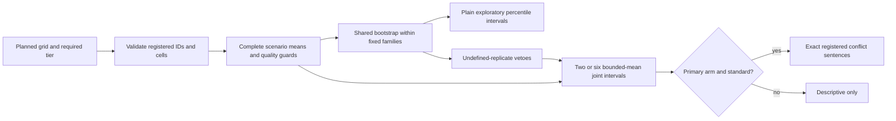

# versus reference estimator and synthetic evidence

Current reference: **draft 4**, standard primary-arm rho/kappa conclusions
only. The previous 1.7 bootstrap rule is refuted. Its failed evidence remains
in [REFUTATION.md](results/REFUTATION.md) and the old CSVs. The repaired rule
uses a Hoeffding union radius for every primary conflict mean, including
stochastic and saturated means. It has a conditional independent-scenario
guarantee, at a substantial moderate-effect power cost. Quick and non-primary
arms are descriptive. No model/network calls, bank freeze or live validation
are part of this kit. [PREREG.md](../PREREG.md) specifies the prospective pilot.

## Where execution starts and how data flows

`versus_estimator.estimate(rows, participants, *, tier)` (the repository root's `versus_estimator.py`, which
this folder's scripts import) requires the tier. Standard
accepts only the complete registered plan in every arm/pair: 48 allocation
and 48 conflict scenarios (six IDs per fixed family), 12 triads for three
names, and 32 source errand tasks. Quick accepts its registered two-per-family
subset or a full standard table; both stay descriptive when requested as
quick. A quick table requested as standard is refused. Source task seeds,
IDs/families, menus, factors and explicit missing reply cells are checked.
Production must map its frozen bank IDs to these reference axes and verify
its additional bank/roster/memory identity before calling this interface.



`prepare` owns point estimates/support through the shared arithmetic helper.
`versus_axes.py` (at the repository root, with the estimator) is the registered ID/family/seed plan.
`make_draws` resamples scenarios
within each fixed family, never families; its full planned axes are shared
across pairs, roles and arms, including unsupported IDs. `versus_bounds.py` is the
one radius formula. `decide_claims` is the one current decision function;
simulations call it on precomputed replicate arrays, without duplicating the
rule. `simultaneous` adds descriptive rows; `sentences` renders exact templates
and explicit guard reasons/counts using frozen referents. `accelerated.py`
optionally supplies the same replicate arithmetic through NumPy. Its old
summary function and `policy_options.py` delegate historical decisions to
`versus_legacy_estimator.py`, not to a third copy of max-T.

The joint radius is `100*sqrt(log(2*m/.05)/(2*G))`, where m stays two/six
including failed members, and G is the complete-scenario count. Conditional
on fixed families and independently supported scenarios, expectations and
variances may differ arbitrarily; a union bound permits cross-pair dependence.
The rule does not infer a small range from a few observed constant families.
At G=48 its radii are 21.364950/23.893511 points. Marginal displays are plain
.025/.975 percentile intervals, always labelled exploratory. At least 95%
defined marginal and joint primary draws remain conservative vetoes. Neither
marginal intervals nor non-primary metrics can authorize a direction.

## Reply-table contract

Every row includes `scenario`, `family`, `frame`, `outcome`, `roster` (names or
unfamiliar), and `memory` (on or off). Allocation/conflict rows have a canonical
`pair`, ordered individual/organization/nation. Allocation/triad have a listing;
A/B/C are positions. Allocation C means lottery, while triad C is the third
party. Conflict has T,L,N,W at +/-1, all eight T,L,N cells, W=T*L*N; positive
T means canonical A deploys, positive L the deployer's option is letter A,
positive N it is introduced first, positive W it gets the first job wording.
Conflict C must be normalized to invalid before this API. Errands have a
beneficiary, source seed, outcome valid and numeric solved/thorough/records
values; solved/thorough are binary and records nonnegative. Explicit refused,
recused, invalid and missing codes are distinct, never half-scored.

Allocation requires both listings, conflict all eight runs, triad all six
listings, errands both paired beneficiaries. Surviving scenarios have equal
weight, with surviving family counts exposed. Loss of a planned family
withholds interpretation; original denominators never shrink. Comparators
use exact twins and common validity, recheck guards symmetrically and intersect
sufficient errand components at the point and in each draw. They remain
descriptive. Whole omitted scenarios are plan errors, not silently lost support.

## Fixtures and tests

Forty full-output/refusal fixtures cover the standard page shapes, all three
missing types, separate nonchoices, ties, every arm, memory-off primary,
stochastic above/below, nulls, three-name saturation, the refuting pattern,
quick/standard misuse and the sentence layer. The sixteen joint-boundary
fixtures contain actual tables differing by one run on either side of each
rho/kappa threshold, for both page shapes and signs. `boundaries.json` adds
32 complete-plan guard-neighbor tables. `replicate_boundaries.json` pins
9,500/9,499 defined draws with the complete reply table and explicit replicate
recipe. All ten formerly invisible mutations now fail fixture replay.

**Fixtures pin Python's `random.Random(seed).choice` stream**, ordered by
frame, family and ID. They are not a language-neutral PRNG specification.
Full tables are losslessly stored as a column list plus zlib/base85 JSON row
values, reducing repeated plan metadata. `fixture_io.unpack_rows` recovers
the exact dictionaries and row order without rerunning a synthetic generator.
Fixture output uses 128 draws for speed; error studies use all 10,000.
Current power uses exact lattice convolution, with no random seed.
Both Python 3.10 and Python 3.9 run the stdlib suite; only NumPy agreement is
skipped when NumPy is unavailable. Unknown reason codes fail explicitly.

## Rerun

From the repository root, with raw output paths chosen outside the repository:

```sh
python3 -m unittest discover -s docs/versus/sim
python3 docs/versus/sim/make_fixtures.py
python3 docs/versus/sim/make_boundary_fixtures.py
OPENBLAS_NUM_THREADS=1 python3 docs/versus/sim/refutation_check.py
OPENBLAS_NUM_THREADS=1 python3 docs/versus/sim/repair_study.py selection --raw /your/scratch/selection.jsonl
OPENBLAS_NUM_THREADS=1 python3 docs/versus/sim/repair_study.py validation --raw /your/scratch/validation.jsonl
python3 docs/versus/sim/exact_power.py
OPENBLAS_NUM_THREADS=1 python3 docs/versus/sim/bridge_check.py
OPENBLAS_NUM_THREADS=1 python3 docs/versus/sim/mutation_audit.py --scratch /your/scratch/mutations
OPENBLAS_NUM_THREADS=1 python3 docs/versus/sim/standard_controls.py
OPENBLAS_NUM_THREADS=1 python3 docs/versus/sim/descriptive_widths.py
python3 docs/versus/sim/current_report.py
```

The study uses at most three worker processes and one BLAS thread each.
`--supplement` reruns only the final six explicitly added original-blocking
variants, with the same cell indices/seeds. Completed combined CSVs include
those rows; supplement CSVs preserve the separate run. Selection seeds are
21000000+1000*cell_index+page_index; validation 22000000+1000*cell_index+
page_index. These error streams are disjoint; current power is exact. Selection
has 100 pages/cell; validation has 400 for old-grid/verifier cells and 100
for each near-saturated search cell. Bootstrap seed is 2026111117.

The 40 old cells include fixed-family global/mixed/unbalanced truths, stable/
noisy replies and independent/shared pairs. Eighteen verifier cells retain
heteroscedastic, W-pattern, rare-outlier, pair-specific, independent-missing,
name-follower, bimodal and original BL/V1/V2 failures. The 480-cell search
crosses names=2/3, erratic families=1/2/3, a=.10/.15/.20/.25/.30/1/3/.35/.40/
5/12/.45, stable/noisy types, deployer/W bases and deployer/W remainders.
It uses exact sufficient statistics with guards conservatively forced to
pass. Every direction still uses the reference and actual joint replicates.
The bridge reconstructs 32 coupled full grids and checks 128 member vectors
and decisions. For these nulls the deterministic deviation is at most 18.75
points, below the new radius; the search's zero false directions is expected.

## Current result schemas

`repair_rule.json`: version, rule, selection/audit gates, counts, stream and
bootstrap seeds, worst upper bound/cell, fitted_constants false, registered
false and live_calibrated false. `SUMMARY.md` is generated from actual CSVs.

`repair_selection.csv` / `repair_validation.csv`: stage, cell JSON, pages,
false_pages, rate, upper95/lower95 Wilson bounds, seed_base, bootstrap_seed,
replicates, path (full_plan_and_guards or conservative_sufficient_statistics).
Every cell's upper bound must be strictly below 5%; pooling cannot pass a
failed cell. Monte Carlo bounds are per cell, not simultaneous over the grid.

`repair_power.csv`: names, stability, family_effects, metric, truth,
complete_scenarios, new_power, new_radius, method, conditioning. All 32 cells
integrate the strict registered direction by exact convolution on 12.5-point
scenario values. This assumes complete support and forces other quality vetoes to pass.
It upper-bounds full-pipeline power under these generators and does not
integrate refusals or quality-guard failures. There are
no Monte Carlo intervals or seeds. `exact_power.py` implements this offline
calculation, using NumPy when available and a standard-library fallback.

`callable_effects.csv`: names, stability, family_effects, G,
value_for_80pct, G_for_65/70, balanced_G_for_65/70. G=48 thresholds apply
to either rho or kappa under these generators. Without family effects,
G requires 80% power for itself and the next 16 integer sizes; its balanced
column rounds up to a multiple of eight. With effects, balanced banks advance
by eight and the next 16 banks must pass. Lattice discreteness means this
local persistence convention is not a proof for every larger bank size.

`historical_repair_power_mc160.csv` retains the earlier old/new paired
comparison, with 160 pages and shared seeds across cells. Its two overstated
stable-agent cells are why it was replaced; it is historical, not the
current power result. Old/new success counts, Wilson intervals and seeds
remain for traceability.

`refutation_exact.csv`: names, a, configurations, probability_mass,
old_exact_false_probability/new_exact_false_probability, bootstrap seed and
replicate count. Exact enumeration is distinct from Monte Carlo bounds.
`repair_bridge.json`: coupled page/member counts, mismatches, stream, replicates.
`repair_mutations.csv`: mutation, caught, caught_by (fixture/test identifiers).

`repair_losses.csv` has names, tier, stability, family_effects, regime,
joint_rule, outer_pages, false_pages/rate, mc95_low/high, eligible_rate,
conditioning. It uses the earlier independent loss-control stream, now through
the repaired rule; it is supplemental, not the fresh selection/audit stream.
`repair_adversaries.csv`: names, tier, policy, metric, estimate, inferential,
decision, eligible, reasons; 128-draw deterministic mapping checks.
`repair_descriptive_widths.csv`: names, tier, stability, family_effects,
metric, nominal_truth, inferential false, power not_applicable, outer_pages,
defined_interval_rate, median_marginal_half_width, mean_estimate, inflation
(always 1), bootstrap_replicates. These use the previous width stream with
plain displays, not independent confirmatory data.

## Historical CSV schemas and evidence

Everything below without a repair_ prefix describes an earlier instrument
or a rejected display policy. Historical scripts intentionally bypass current
claim gates to reproduce why they were changed. Their successful old cells
do not certify the current or refuted rule beyond those cells. The original
selection/validation seeds were 13000000/16000000; original power 17000000.
The two-tier exploratory audit used 14000000 and power 15000000. The
21-test evidence, loss controls and inflated widths remain intact.

`standard_rule.json`: historical scorer/version, policy, quick gate, selected
inflation, fine grid, seeds, counts, selection criterion/fallback flag and
synthetic audit pass/bound. `registered=false` and `live_calibrated=false`
are intentional even if the synthetic grid passes.

`standard_selection.csv`: `inflation`, `family_effects`, `cells`,
`outer_per_cell`, `worst_rate`, `worst_cell` (JSON for names, stability,
shared-pair state and conditional-null case). This is selection, not an audit.

`standard_validation.csv`: `names`, `tier`, `stability`, `family_effects`,
`shared_pairs`, `case`, `inflation`, `outer_pages`, `false_pages`, `false_rate`,
`mc95_low/high`, `upper_under_05`, `eligible_rate`, `bootstrap_replicates`.
Cases are conditional-global, conditional-mixed, conditional-unbalanced.
A false page is any false directional sentence, including the wrong sign
for a non-null. Passing requires *every* upper bound below 5%; pooled counts
cannot clear a failing cell.

`standard_power_width.csv`: `names`, `tier`, `stability`, `family_effects`,
`metric`, `conditional_truth`, `inflation`, `outer_pages`, `power`,
`power_mc95_low/high`, `eligible_rate`, `median_marginal_half_width`,
`mean_estimate`, `bootstrap_replicates`. Power is the first pair's correct
simultaneous direction with full page multiplicity, including withheld pages
in its denominator, not the probability of discovering every true relation.
Half-width is points on defined exploratory intervals. A measured zero is
not a proof of zero population power.

`descriptive_widths.csv`: `names`, `tier`, `stability`, `family_effects`,
`metric`, `nominal_truth`, `inferential` (false), `power` (not applicable),
`outer_pages`, `defined_interval_rate`, `median_marginal_half_width`,
`mean_estimate`, `inflation`, `bootstrap_replicates`. It covers allocation
60/65/70 and errands 60/65 at both tiers, plus quick rho 65/80 and kappa
60/70. All use the historical 1.7 display rule. No untested row is given a
spurious “power” or a directional sentence.

`standard_losses.csv`: `names`, `tier`, `stability`, `family_effects`, `regime`,
`inflation`, `outer_pages`, `false_pages`, `false_rate`, `mc95_low/high`,
`eligible_rate`, `conditioning`. Regimes are independent invalid/refused/
recused 10% and invalid 20%. Conditional truth uses the actual retained-family
scenario weights. Outcome-dependent missingness is not corrected.

`historical_adversaries.csv`: `names`, `tier`, `policy`, `metric`, `estimate`,
`inferential`, `decision`, `eligible`, `reasons`. It shows the representative
person:organization pair and all triad shares for each deterministic policy;
the other pairs have the same mapping. The full older all-pair adversary
table is also retained. This deterministic mapping/guard check uses 128
fixture draws, not a second FWER audit.

`stratified_zero_variance.csv`: `family_size`, `clusters`, `radius`,
`enough_clusters`, `always_deployer_resolves`, `role_average_50_resolves`,
`subject_to_other_guards`. These are analytic bounded-mean radii for historical
m=2/6, compared with the earlier point-interval/always-withhold alternatives
in `zero_variance.csv`. It never applies the bound to a nonlinear ratio.

## Earlier evidence retained

`error_selection.csv` / `error_validation.csv` use the old unstratified 6/21
family: stage, names, tier, stability, family-clustered flag, shared-pairs
flag, global/mixed null, inflation, outer/false pages, rate, Wilson bounds,
upper-under-.05 flag, eligible-member rate and bootstrap count.
`power_width.csv` adds metric, truth, unconditional full-family power and its
bounds, eligibility, marginal half-width and mean point estimate. It includes
the now-descriptive allocation/errand alternatives as historical power only.

`guard_sweep.csv`: rule, candidate, chosen, regime, metric, outer pages,
eligible rate. Candidate position bands are serialized pairs. These are
quality/readability choices on 20 synthetic pages/regime, not a 5% inferential
certification. `undefined.csv` varies max undefined .01/.05/.10 and records
rare successes per party, undefined fraction, bootstrap count, point,
interval availability and sentence eligibility. `zero_variance.csv` records
family size, clusters, true share, candidate policy/radius, saturated-zero/
one directions, analytic saturation error and its family union bound.

`stress.csv` records old-rule names/tier/regime, outer/false pages, rate,
Wilson bounds and eligible rate. `adversaries.csv` records old-rule names,
policy, full metric key, point, quality eligibility, decision, guard reasons
and diagnostic JSON. `comparator_checks.csv` records names, regime, contrast,
metric, point, eligibility, planned/common/lost twins, marginal endpoints and
replicate count: exact-zero, recognition-recusal and differential loss cases.

`policy_selection.csv` / `policy_validation.csv` compare the original full
family, rho+kappa, rho-only, kappa-only and per-pair control on three-name
shared-pair pages. Their factors include controlled unit, worst-scope errors/
rate/bound and any-page errors/rate/bound; a per-pair scope is the worst of
three individual pair rates, not the pooled rate. `policy_rules.csv` records
the selected inflation/fallback by policy and family-dependence case.
`policy_comparison.csv` is the single requested alternative-policy table:
names, policy, family effects, tier, stability, metric, truth, applicability,
selected inflation, outer pages, power/bounds, eligibility, worst scope/page
audit bounds, scope/page pass flags and bootstrap count. Untested metrics
have empty power entries. Selected inflation is a finite-grid result, not a
universal minimum. Per-pair error control does not generally imply 5%
whole-page control.

`stratified_selection.csv` summarizes the earlier two-tier fine grid by
inflation/family flag: cells, outer count, worst rate/bound and worst-cell JSON.
`stratified_validation.csv` adds case, conditional-truth minimum/maximum,
selection/audit stage, factors, errors/bounds, eligibility and bootstrap count.
`stratified_power_width.csv` records the old 3.0 rule's factors, nominal and
conditional truths, inferential flag, outer pages, power/bounds, eligibility,
width, mean, both inflation values and bootstrap count. Its quick “power”
is a rejected-policy diagnostic, never historical authorization to conclude.
`stratified_rule.json` preserves that fallback/audit and `rule.json` the
still-earlier 21-test rule. `HISTORICAL_SUMMARY.md` explains the original
policy comparison; `SUMMARY.md` leads with the current bounded rule and exact power.
